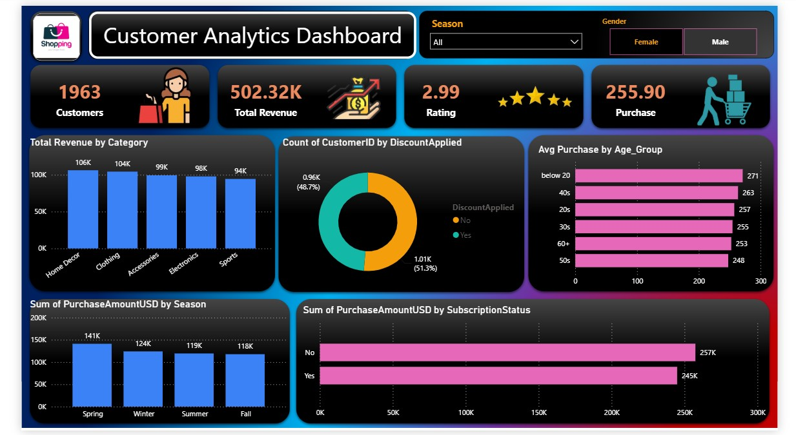
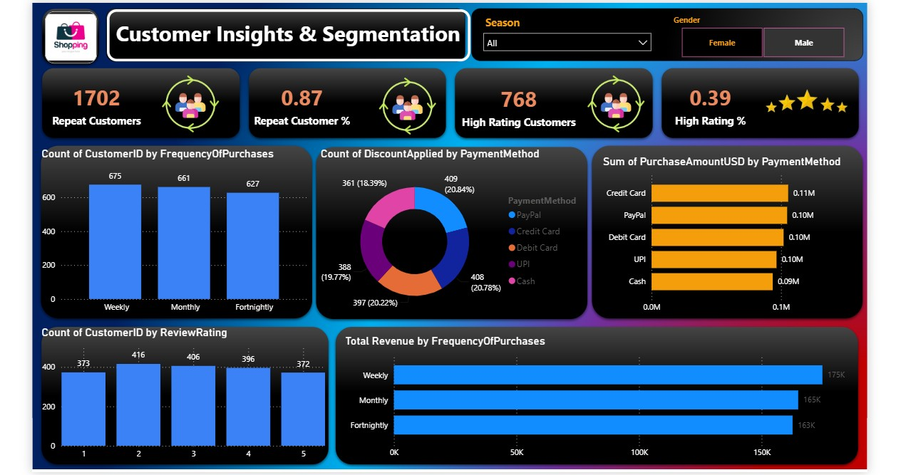

# Customer Segmentation Analysis

A data analytics project exploring customer purchasing behaviour, sales performance, discount strategies, seasonal trends, and customer segmentation using Python, SQL, and Power BI.

1. Project Overview

This project analyses customer shopping behaviour to identify purchasing patterns, understand revenue distribution, evaluate discount strategies, and segment customers into meaningful groups.

Using a dataset of 3,900 customer records and 19 features, the project combines SQL analysis, Python-based exploratory data analysis and K-Means clustering, and interactive Power BI dashboards to generate business insights and support data-driven marketing decisions.

2. Business Problem Statement

Retail businesses need to understand their customers to improve sales performance, customer engagement, and marketing effectiveness.

This project addresses the following business questions:

- Which product categories generate the highest revenue?
- How do discounts influence customer spending?
- Which age groups demonstrate higher average spending?
- How does seasonal purchasing behaviour affect sales?
- What distinct customer groups can be identified through clustering?
- What marketing strategies can improve customer loyalty and retention?

3. Dataset Summary

Dataset: Customer Shopping Trends Dataset

Attribute| Description
Total Records| 3,900
Total Features| 19
Data Type| Structured / Tabular
Missing Values| None reported in the original analysis

Key dataset features:

- CustomerID
- Age
- Gender
- ItemPurchased
- Category
- PurchaseAmountUSD
- Location
- Size
- Color
- Season
- ReviewRating
- SubscriptionStatus
- ShippingType
- DiscountApplied
- PromoCodeUsed
- PreviousPurchases
- PaymentMethod
- FrequencyOfPurchases
- Age_Group

The dataset provides information about customer demographics, product preferences, purchasing activity, payment methods, discounts, and customer reviews.

4. Tools and Technologies

Tool| Purpose
Microsoft Excel| Data inspection and preparation
MySQL Workbench| SQL querying and data analysis
Python| Exploratory data analysis and customer segmentation
Pandas| Data manipulation and analysis
NumPy| Numerical analysis
Matplotlib| Data visualization
Scikit-learn| StandardScaler and K-Means clustering
Power BI| Interactive dashboards and business reporting
PowerPoint| Project presentation

5. Project Workflow

The project follows an end-to-end data analytics workflow.

Step 1: Dataset Exploration

- Examined the dataset structure and available features.
- Reviewed data types and descriptive statistics.
- Checked for missing values.

Step 2: SQL Analysis

Used SQL to explore customer purchasing behaviour and calculate business metrics, including:

- Category-wise sales and revenue.
- Discount distribution.
- Average spending by age group.
- Discount impact on average spending.
- Seasonal sales performance.
- Top five high-spending transactions.

Step 3: Python Analysis

Used Pandas and Matplotlib to analyse:

- Category-wise sales performance.
- Discount distribution across categories.
- Average spending based on discount usage.
- Age-group spending patterns.
- Seasonal purchasing behaviour.

Step 4: Customer Segmentation

Applied K-Means clustering using four features:

- Age
- PurchaseAmountUSD
- PreviousPurchases
- ReviewRating

StandardScaler was used to standardize the selected features before applying K-Means with three clusters.

Step 5: Power BI Visualization

Developed a two-page dashboard to present business performance and customer insights.

6. Key Business Insights

Category-wise Sales

- Clothing generated the highest revenue at approximately $208,775.
- Accessories followed closely at approximately $208,063.
- Sports recorded the lowest revenue among the five categories.

Discount Analysis

- 1,897 transactions used discounts.
- 2,003 transactions did not use discounts.
- Average spending was approximately $255.83 without discounts and $255.11 with discounts.

Age Group Spending

- Customers aged 36–50 recorded the highest average spending in the Python analysis, at approximately $261.34.
- Customers aged 50+ recorded the lowest average spending, at approximately $248.76.

Seasonal Analysis

- Spring recorded the highest average spending at approximately $259.73.
- Summer recorded the lowest average spending at approximately $250.98.

Customer Segmentation

Three customer clusters were identified:

Cluster| Customer Segment| Average Purchase| Previous Purchases
0| High Value Customers| $271.52| 11.46
1| Regular Buyers| $252.16| 3.89
2| Mature Low-Spend Segment| $240.02| 4.60

The analysis identified a high-value customer group with stronger purchasing activity and a separate group of customers with lower average spending.

Power BI Dashboard Findings

- Total customers: 1,963
- Total revenue: approximately $502.32K
- Average review rating: 2.99
- Repeat customers: 1,702
- Repeat customer percentage: 87%
- High-rating customers: 768

7. Business Recommendations

Based on the project findings, the following strategies are recommended.

High Value Customers

- Introduce loyalty and reward programs.
- Provide exclusive premium offers.
- Offer early access to new products.

Regular Buyers

- Introduce seasonal promotions.
- Create product bundle offers.
- Use targeted campaigns to encourage more frequent purchases.

Mature Low-Spend Segment

- Provide targeted discount coupons.
- Introduce personalized product recommendations.
- Develop customer retention campaigns.

Additional Business Strategies

- Optimize discount campaigns instead of relying on blanket discounts.
- Plan inventory and marketing activities around seasonal demand.
- Monitor customer ratings to identify areas for service improvement.
- Use customer purchasing patterns to develop more personalized marketing campaigns.

8. Project Deliverables

The project repository contains the following deliverables:

File| Description
"Shoping_table_std.csv"| Customer shopping dataset
"SQL Customer_Segmentation.sql"| SQL analysis queries
"Customer_Segmentation.ipynb"| Python analysis and K-Means clustering
"Customer Segmentation.pbix"| Two-page Power BI dashboard
"CDACL-002-Customer Segmentation.pptx"| Project presentation
"Executive Overview.jpg"| Dashboard page 1 screenshot
"Duplicate of Executive Overview.jpg"| Dashboard page 2 screenshot
"README.md"| Project documentation

Power BI Dashboard Preview

Page 1 – Executive Overview

Page 2 – Customer Insights and Segmentation

9. Skills Demonstrated

- Data exploration and inspection
- SQL querying and aggregation
- Exploratory Data Analysis (EDA)
- Data manipulation using Pandas
- Statistical analysis
- Data visualization using Matplotlib
- Feature scaling and K-Means clustering
- Customer segmentation
- Power BI dashboard development
- Business intelligence and data storytelling
- Translating analytical findings into business recommendations

10. Conclusion

This project demonstrates how customer shopping data can be transformed into meaningful business insights through SQL, Python, machine learning, and Power BI.

The analysis explored revenue distribution, discount usage, age-group spending, seasonal trends, and customer purchasing behaviour. K-Means clustering identified three distinct customer segments, providing a foundation for more targeted marketing and customer retention strategies.

The Power BI dashboards bring together key business metrics and analytical findings to support informed decision-making.

11. Acknowledgement

Credit and appreciation to Khush Panchal for the original Customer Segmentation Capstone project, which served as the reference for this project.

Original project repository:

"Customer Segmentation Capstone – Khush Panchal" (https://github.com/khush3521/Customer-Segmentation--Capstone-Project)

This project is an adapted learning and portfolio implementation based on the original project and its accompanying materials.
